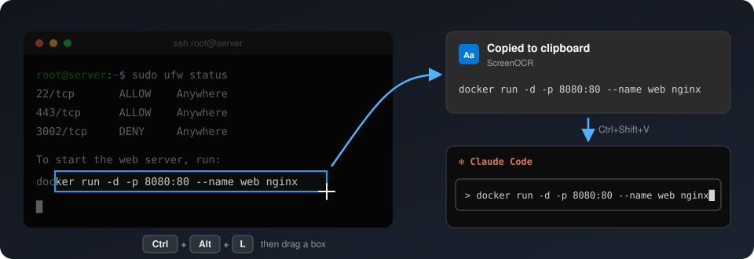
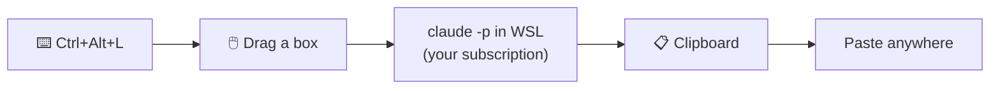

<div align="center">

# ScreenOCR

**Grab any text on your screen with a shortcut. Claude reads it exactly, and you paste it anywhere.**<br>
Made for people who work in SSH sessions and terminal tools like Claude Code. Uses your Claude Code subscription, no API key.


[](LICENSE)



</div>

## The problem it solves

If you work in a remote terminal on Windows (SSH, WSL, tmux, Claude Code running on a server), copying and pasting gets painful:

| 😤 The pain | ✅ With ScreenOCR |
|---|---|
| You can't paste screenshots into a **remote** Claude Code session. The clipboard is on your PC, and Claude Code is on the server. | Grab the text from the screenshot and paste it as text. |
| Copying from full-screen terminal apps (Claude Code, tmux, vim) is fiddly, or the copy comes out with broken line wraps. | Drag a box over exactly what you want. |
| Some text can't be selected at all: remote desktops, videos, images, locked-down apps. | If you can see it, you can grab it. |

## How to use it

<table>
<tr>
<td align="center" width="25%"><h3>1️⃣</h3>Press<br><kbd>Ctrl</kbd>+<kbd>Alt</kbd>+<kbd>L</kbd></td>
<td align="center" width="25%"><h3>2️⃣</h3>The screen freezes.<br><b>Drag a box</b> around the text.</td>
<td align="center" width="25%"><h3>3️⃣</h3>A notification shows<br><b>"Copied to clipboard"</b></td>
<td align="center" width="25%"><h3>4️⃣</h3>Paste in your terminal:<br><kbd>Ctrl</kbd>+<kbd>Shift</kbd>+<kbd>V</kbd></td>
</tr>
</table>

Press <kbd>Esc</kbd> or right-click to cancel a grab. You can also left-click the blue **Aa** icon in the system tray to grab.

## Why Claude?

- **Exact.** A single wrong character breaks a command. Claude got every test command right, including hashes, API keys, quotes and `|`, `~`, `$(...)`, which classic OCR engines regularly get wrong. In our tests, Windows' built-in OCR got only 27% of shell commands exactly right.
- **Fast enough.** About **2–4 seconds** per grab.
- **No API key, no per-grab cost.** It runs through `claude -p`, Claude Code's official non-interactive mode, on your existing subscription. Each grab counts toward your plan's usage like a small Claude Code message.

> [!NOTE]
> The grabbed image is sent to Anthropic, like anything else you send to Claude. Think twice before grabbing passwords or secrets.



## Install

> [!NOTE]
> **Requirements:** Windows 10 or 11, and [Claude Code](https://code.claude.com) installed and logged in **inside WSL** (your default distro).<br>
> Check by running `claude -p "say hi"` in WSL. It should answer without asking you to log in.

1. **Download** this repo: **Code → Download ZIP**, or clone it.
2. **Put the folder on your Windows drive**, e.g. `C:\Users\<you>\ScreenOCR`. Don't run it from a `\\wsl$\...` path.
3. **Double-click `ScreenOCR.vbs`.** The blue **Aa** icon appears in the system tray, and a notification confirms the shortcut.
4. *Optional:* right-click the tray icon and tick **Start with Windows**.

If Windows warns you the first time, choose **More info → Run anyway**. The only files that run are `ScreenOCR.vbs` and `ScreenOCR.ps1`, and both are short and readable.

To stop it, right-click the tray icon and choose **Exit**.

## Customize

Edit the `param(...)` block at the top of `ScreenOCR.ps1`, then restart ScreenOCR:

```powershell
[string]$Hotkey = 'Ctrl+Alt+L',
[string]$ClaudeModel = 'sonnet'    # or 'haiku' (lighter on usage, slightly less exact)
```

The shortcut can combine `Ctrl`, `Alt`, `Shift` and `Win` with a key, e.g. `'Win+Shift+O'`. If it's already taken by another program, ScreenOCR tells you on startup, and clicking the tray icon still works.

## Tips for terminal users

- **Copying in Windows Terminal without ScreenOCR:** hold <kbd>Shift</kbd> while dragging to select text even when Claude Code, tmux or vim is capturing the mouse. Then press <kbd>Ctrl</kbd>+<kbd>Shift</kbd>+<kbd>C</kbd> to copy.
- **Real images** (diagrams, UI screenshots): OCR only gets the text. If Claude needs to see the actual image, copy the image file to the server and give Claude Code its path.
- **Tables and box-drawing characters** come through. Column padding may be slightly uneven, but all the text is there.

## Troubleshooting

<details>
<summary><b>Pressing the shortcut types a letter like <code>Ó</code> instead of grabbing</b></summary>

ScreenOCR isn't running, or it couldn't register that shortcut. On some keyboard layouts, Ctrl+Alt works like AltGr and types accented letters. Check that the tray icon is there, or start `ScreenOCR.vbs` again.
</details>

<details>
<summary><b>"ScreenOCR (Claude) error" notification</b></summary>

The message is Claude Code's own error. The usual causes:

- Claude Code isn't installed in your default WSL distro.
- You're logged out. Run `claude` in WSL once to log in.
- You've hit your plan's usage limit.

If a grab ever seems stuck, ScreenOCR retries it once with a fresh Claude instance after 15 seconds. Every step is logged to `%LOCALAPPDATA%\ScreenOCR\screenocr.log`. Please attach that file if you open an issue.
</details>

<details>
<summary><b>The selection box doesn't line up with the screen</b></summary>

This can happen with multiple monitors or display scaling. Please [open an issue](../../issues) with your monitor setup.
</details>

## How it works under the hood

ScreenOCR is a single PowerShell script with nothing to install. It uses WinForms for the tray icon, the selection overlay and the global shortcut.

It sends the grab to `claude -p` inside WSL, with the image inside the message, and asks Claude to transcribe it exactly. `claude -p` uses your normal Claude Code login. ScreenOCR never reads or handles your credentials.

To keep grabs fast, ScreenOCR keeps **one Claude Code instance started and waiting** in WSL, so start-up time isn't part of the wait. Each instance handles a single grab and is then replaced by a fresh one, so grabs never pile up in one conversation. It is also replaced every 30 minutes, and it shuts down when you exit ScreenOCR.

You can also read an image file from the command line:

```powershell
powershell -ExecutionPolicy Bypass -File ScreenOCR.ps1 -OcrFile screenshot.png
```

## License

MIT. See [LICENSE](LICENSE).
